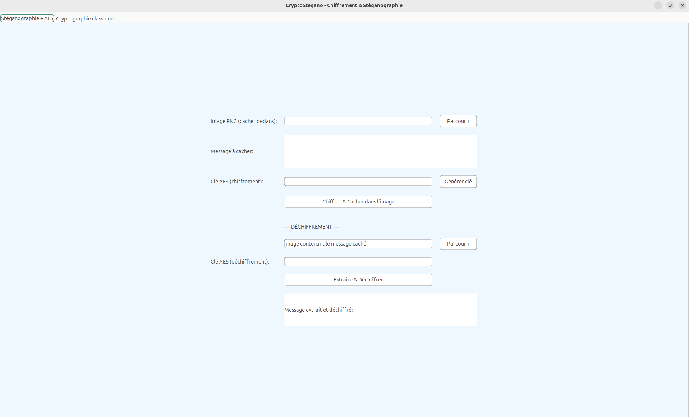
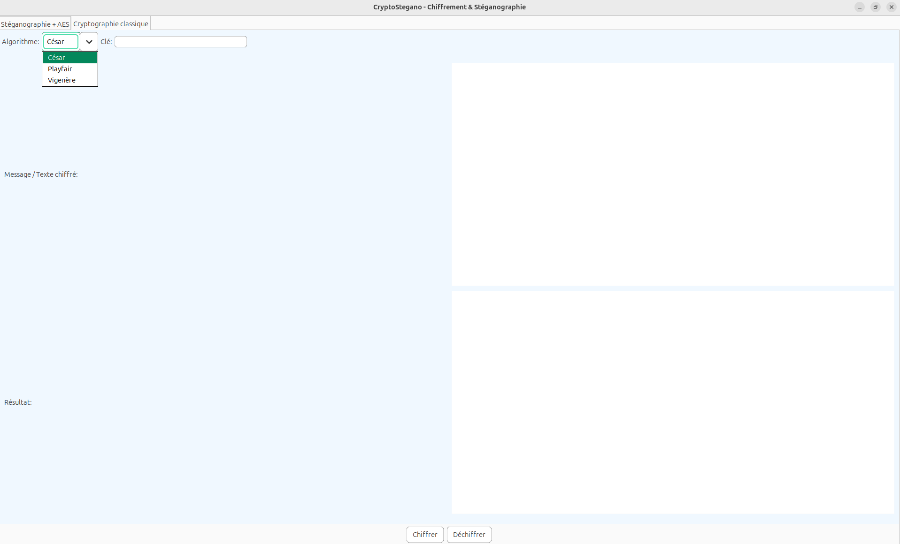

# 🔐 CryptoStegano

**Application de chiffrement et de stéganographie en Java (Swing)**

Mini-projet du module **Sécurité** — 3ᵉ année Ingénieur en Génie Logiciel.

> Réalisé par **Guelaache Hocine** (2025/2026)


---

## 📖 Description

**CryptoStegano** est une application de bureau qui combine deux domaines de la sécurité de l'information :

1. **Stéganographie + AES** : un message est chiffré avec **AES-256-GCM**, puis caché dans une image PNG grâce à la technique **LSB** (Least Significant Bit).
2. **Cryptographie classique** : chiffrement et déchiffrement de texte avec les algorithmes **César**, **Playfair** et **Vigenère**.

---

## 🖼️ Captures d'écran

| Stéganographie + AES | Cryptographie classique |
|:---:|:---:|
|  |  |

---

## ✨ Fonctionnalités

### Onglet « Stéganographie + AES »
- Génération d'une clé AES-256 aléatoire (affichée en hexadécimal)
- Chiffrement du message en **AES/GCM/NoPadding** (IV aléatoire de 12 octets, tag d'authentification de 128 bits)
- Dissimulation des données chiffrées dans les bits de poids faible (LSB) des canaux R, G, B d'une image
- Sauvegarde de l'image résultante au format PNG (sans perte) sous le nom `<image>_stego.png`
- Extraction et déchiffrement du message à partir d'une image stégo avec la clé

### Onglet « Cryptographie classique »
- Algorithmes : **César** (clé = décalage entier), **Playfair** (clé = mot), **Vigenère** (clé = mot)
- Chiffrement et déchiffrement d'un texte saisi

---

## 🗂️ Structure du projet

```
├── screenshots/                  # Captures d'écran 
│   ├── Stegnogaraphie+AES.png
│   └── Cryptographie-classique.png
├── CryptoSteganoApp/ 
    ├── CryptoSteganoApp/
        ├── lib/                         
        └── src/fr/securitycrypto/
            ├── crypto/                   # AESCipher, CaesarCipher, PlayfairCipher, VigenereCipher
            ├── service/                  # SteganoService, ClassicCryptoService
            ├── steganography/            # LSBEncoder, LSBDecoder
            ├── ui/                       # MainFrame, SteganoPanel, ClassicCryptoPanel
            └── utils/                    # KeyUtils, FileUtils
```

L'architecture sépare l'interface (`ui`), la logique métier (`service`) et les algorithmes (`crypto`, `steganography`).

---

## ⚙️ Prérequis

- **JDK 17 ou plus récent** (le code utilise `java.util.HexFormat`, disponible à partir de Java 17)
- Aucune bibliothèque externe

Vérification :

```bash
java -version
javac -version
```

---

## 🚀 Compilation et exécution

### Depuis le terminal

À la racine du projet :

**Windows (PowerShell)**
```powershell
mkdir out
javac -encoding UTF-8 -d out (Get-ChildItem -Recurse src -Filter *.java).FullName
java -cp out fr.securitycrypto.ui.MainFrame
```

**Linux / macOS**
```bash
mkdir -p out
javac -encoding UTF-8 -d out $(find src -name "*.java")
java -cp out fr.securitycrypto.ui.MainFrame
```

### Créer un JAR exécutable (optionnel)

```bash
jar cfe CryptoStegano.jar fr.securitycrypto.ui.MainFrame -C out .
java -jar CryptoStegano.jar
```

### Depuis VS Code

1. Installer l'extension **Extension Pack for Java**
2. Ouvrir le dossier `CryptoSteganoApp`
3. Ouvrir `src/fr/securitycrypto/ui/MainFrame.java` puis cliquer sur **Run** (ou `F5`)

---

## 🧪 Utilisation

### Cacher un message
1. Onglet **Stéganographie + AES**
2. Choisir une image de couverture
3. Générer une clé AES et la **conserver précieusement**
4. Saisir le message puis cliquer sur *Chiffrer et cacher*
5. L'image `*_stego.png` est créée à côté de l'image d'origine

### Extraire un message
1. Choisir l'image `*_stego.png`
2. Saisir la clé AES utilisée
3. Cliquer sur *Extraire et déchiffrer*

---

## ⚠️ Limites

- Projet **pédagogique** : à ne pas utiliser pour protéger des données réellement sensibles.
- César, Playfair et Vigenère sont des chiffrements historiques, **facilement cassables**.
- Le LSB n'est pas robuste : toute compression avec perte (JPEG) ou redimensionnement détruit le message caché. Utiliser uniquement le format **PNG**.
- La capacité dépend de la taille de l'image (≈ `largeur × hauteur × 3 / 8` octets).

---

## 📚 Concepts abordés

- Chiffrement symétrique authentifié (AES-GCM)
- Stéganographie par substitution LSB
- Cryptographie classique (substitution monoalphabétique, polyalphabétique, digrammes)
- Programmation orientée objet et architecture en couches
- Interface graphique avec Java Swing

---

## 📄 Licence

Ce projet est distribué sous licence **MIT**. Voir le fichier [LICENSE](LICENSE).

---

## 👤 Auteur

**Guelaache Hocine**
Module : Sécurité
